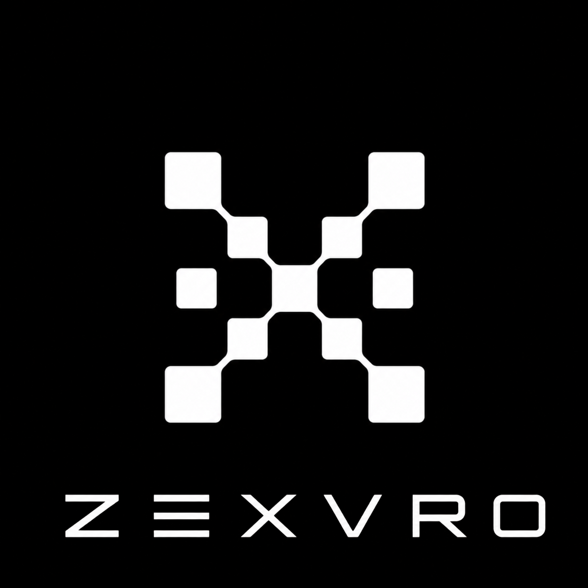

<p align="center">
  
</p>

<p align="center">
  <strong>Unified Web3 PaaS for teams building private, verifiable, agent-ready infrastructure.</strong>
</p>

<p align="center">
  <a href="context.md">Context</a>
  ·
  <a href="memory.md">Shared Memory</a>
  ·
  <a href="design.md">Design</a>
  ·
  <a href="frontend">Frontend</a>
  ·
  <a href="assets/brand">Brand Assets</a>
</p>

<p align="center">
  
  
  
  
</p>

---

## Vision

ZEXVRO is a clean, developer-first platform for moving Web2 products into Web3 infrastructure without exposing teams to unnecessary blockchain complexity.

The product direction is simple: Vercel/Cloudflare-level clarity, Web3-native rails, and an agent-first workflow that helps developers move faster without losing project context.

## Repository

This repository currently holds the project foundation:

- `AGENTS.md` - agent boot checklist, remaining work, ticket owners.
- `context.md` - product, team, stack, setup, active remaining work, and marketing surfaces.
- `memory.md` - shared working memory for developers and agents.
- `design.md` - visual system, themes, typography, product + marketing UI rules.
- `docs/marketing.md` - marketing kit brief, service one-liners, motion inventory.
- `docs/roadmap-unified-paas.md` - the full plan/roadmap: unify the platform base (registry, gateway, identity, credits, workspace, audit), then programs/team/first client.
- `frontend/` - Vite + React frontend workspace (dashboard + in-app welcome).
- `landing/zexvro/` - standalone public landing site.
- `frontend/public/marketing/` - product cinema and brand motion assets.
- `presentation/` - pitch decks (`ppt/`), masters (`video/`), previews (`demo-video/`), sources (`imp/`).
- `assets/brand/` - logo, typo logo, and brand design assets.
- `marketing.zip` - optional local export pack (gitignored); rebuild via `context.md`.

Before starting work, read `context.md` and `memory.md`. After meaningful changes, update `memory.md` and commit the memory update with the code.

## Local Development

Use the repository root as the control point for local config and servers:

```bash
cp .env.example .env
npm run dev
```

`npm run dev` starts the NFT API and frontend together. The root dev script loads
`.env` and `.env.local`, injects the same environment into both processes, and
uses the local Stellar CLI identity in `ZEXVRO_STELLAR_IDENTITY` when
`STELLAR_SPONSOR_SECRET` is empty.

```bash
npm run dev:all
```

Use `dev:all` when you also want the De-pin gateway. Keep real secrets only in
root `.env` or your shell; folder-level `.env.example` files are compatibility
pointers to the root template.

## NFT smoke

After `npm run dev`, check the API with:

```bash
npm run nft:smoke
```

Full signed-in browser steps live in `services/nft-service/README.md`.

## Mainnet contracts and identifiers

These are the on-chain identifiers evaluators need to verify the live infrastructure. Everything listed here is deployed on **Stellar mainnet**.

| Item | Identifier |
| --- | --- |
| Network | Stellar Public Network (`Public Global Stellar Network ; September 2015`) |
| Native XLM SAC | `CAS3J7GYLGXMF6TDJBBYYSE3HQ6BBSMLNUQ34T6TZMYMW2EVH34XOWMA` |
| Circle USDC SAC | `CCW67TSZV3SSS2HXMBQ5JFGCKJNXKZM7UQUWUZPUTHXSTZLEO7SJMI75` |

### NFTo

| Item | Identifier |
| --- | --- |
| Collection WASM hash | `4beb4b6f90eb65291db698ca148903cf1946b20b7ffb381f5b1e25fe779af700` |
| Default payment SAC | `CAS3J7GYLGXMF6TDJBBYYSE3HQ6BBSMLNUQ34T6TZMYMW2EVH34XOWMA` (native XLM mainnet) |
| USDC payment SAC (override) | `CCW67TSZV3SSS2HXMBQ5JFGCKJNXKZM7UQUWUZPUTHXSTZLEO7SJMI75` (Circle USDC mainnet) |
| ZCR credit pack collection | `c516b900-b3a0-4997-9ca5-1ca3f9270f4f` |

The NFT collection contract is deployed per collection from the WASM hash above. SAC values are configured per environment; mainnet default is native XLM so buyers do not need a USDC trustline.

### Zer0

| Tier | Contract address |
| --- | --- |
| 1000 XLM pool | `CDRN2ZBO7OBGZYC653FHKQCBQAJWRIEXMHQSPDVMHGW7MQGQB67Q5DEE` |
| 100 XLM pool | `CCLAKHWCPLJDZBFNFHI4E5EUZ23E4HJPETBU5CI3M3TXHSKT4QVBMM3Y` |
| 10 XLM pool | `CC5H2MOIYZSCPZ7GOSUKHIOMHWQRXWJNHEZVYRBGGOGI2FLEOUA3BY6N` |
| 1 XLM pool | `CAMBCV544D7EI72HBXZ4BPEVVMOCIUN6ZBSMPFWX73NRTW7INWUTJRFW` |

Do not commit sponsor keys or wallet seeds.

## What ZEXVRO is

ZEXVRO is a unified Web3 PaaS that helps teams move Web2 products onto private, verifiable, agent-ready infrastructure without managing raw blockchain complexity.

The platform is built around five MVP services:

- **Zer0** — zero-knowledge privacy pool for business payments and proofs.
- **Morph** — transformation agent and CLI for migrating Web2 code and workflows to Web3-ready infrastructure.
- **REQWID** — human-vs-agent capability issuer and gate for dual-channel access control.
- **NFTo** — deploy and sell NFT collections on Stellar Soroban without chain complexity.
- **DEDSEC** — x402 paid-access gateway for APIs and compute resources.

ZEXVRO ships as a Vite + React console, a standalone public landing site, service APIs on AWS (Lambda + App Runner), and the Morph agent CLI. The frontend targets Stellar mainnet NFTo flows and testnet/local paths for services still under active integration. For the current product state, ownership, and remaining work, see [`context.md`](context.md).

