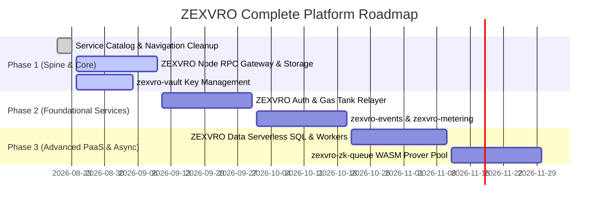

# ZEXVRO Architectural Audit: Proposed Service Catalog, Internal Services & Investor Q&A

> **Document Version**: 2.0.0  
> **Author**: Antigravity AI & Paris / ZEXVRO Architecture Team  
> **Target Audience**: Core Engineering Team, Technical Co-founders, VCs & Grant Auditors  

---

## Executive Overview: The Two-Tiered Service Catalog Vision

To capture developer market share, ZEXVRO must serve two developer needs:
1. **Foundational Web3 & Cloud Infrastructure**: The indispensable, everyday building blocks (RPC, IPFS Storage, Social Auth, Serverless DB, Edge Workers, Gas Relayer) that every developer expects from a Web3 PaaS like Alchemy or Supabase.
2. **Specialized Web3 Innovation Primitives**: The cutting-edge, proprietary flagships (**Zer0**, **Morph**, **REQWID**, **NFTo**, **DEDSEC**) that provide distinct competitive advantages on Stellar/Soroban.

By pairing foundational developer tools with specialized innovation primitives, ZEXVRO positions itself as the complete **Web3 Developer Operating System**.

---

## Part 1: Proposed Complete ZEXVRO Service Catalog

```
+-----------------------------------------------------------------------------------+
|                           ZEXVRO DEVELOPER PLATFORM                               |
+-----------------------------------------------------------------------------------+
|                                                                                   |
|  [ TIER 1: FOUNDATIONAL CORE INFRASTRUCTURE ]                                     |
|  * ZEXVRO Node (RPC & Indexer)         * ZEXVRO Auth (Social & Passkey Embedded)  |
|  * ZEXVRO Storage (IPFS/S3 Drive)      * ZEXVRO Data (Serverless SQL & State)     |
|  * ZEXVRO Functions (Edge Serverless)  * ZEXVRO Relay (Gas Tank & Tx Sponsor)    |
|                                                                                   |
|  [ TIER 2: SPECIALIZED INNOVATION PRIMITIVES ]                                    |
|  * Zer0 (ZK Stealth Payments)          * Morph (AI Dev Agent Studio)              |
|  * REQWID (Bot Security & Agent Auth)  * NFTo (Soroban Asset Studio)             |
|  * DEDSEC (x402 Micropayment Gateway)                                             |
|                                                                                   |
|  [ TIER 3: INTERNAL PLATFORM CONTROL PLANE ]                                      |
|  * zexvro-events   * zexvro-telemetry  * zexvro-vault                          |
|  * zexvro-zk-queue * zexvro-metering   * zexvro-notify                         |
|                                                                                   |
+-----------------------------------------------------------------------------------+
```

### Tier 1: Foundational Core Infrastructure (Developer Essentials)

These essential services ensure developers can migrate their entire stack to ZEXVRO without needing external vendor accounts.

| Service Name | Key Identifier | Description & Developer Value Proposition | Status | Target Stack |
| :--- | :--- | :--- | :--- | :--- |
| **ZEXVRO Node** | `node-rpc` | High-availability, load-balanced Stellar Pubnet/Testnet Soroban RPC endpoints with custom WebSocket subscription streams and instant GraphQL smart contract indexing. | Proposed (P1) | Soroban RPC, Cloudflare Workers, GraphQL |
| **ZEXVRO Storage** | `drive-storage` | S3-compatible object storage paired with dual-pinning IPFS/Arweave and global CloudFront CDN caching for dApp media assets and metadata. | Proposed (P1) | AWS S3, IPFS Pinata, CloudFront |
| **ZEXVRO Auth** | `auth-identity` | Gasless social logins (Google, GitHub, Apple), WebAuthn Passkeys, and embedded non-custodial MPC wallet creation for friction-free Web3 user onboarding. | Proposed (P1) | Passkey/WebAuthn, Turnstile, Privy-compatible |
| **ZEXVRO Data** | `db-serverless` | Serverless PostgreSQL database with automatic on-chain Soroban event listeners that index smart contract state into relational SQL tables. | Proposed (P2) | Neon/RDS Postgres, Prisma, Event Listeners |
| **ZEXVRO Functions** | `edge-functions` | Zero-cold-start serverless JavaScript/TypeScript edge functions triggered by HTTP requests, cron schedules, or on-chain Soroban transactions. | Proposed (P2) | Cloudflare Workers, V8 Isolated Runtime |
| **ZEXVRO Relay** | `gas-tank` | Sponsored transaction relayer engine that signs and pays for user Stellar network fees using workspace ZCR balances (Gasless UX). | Proposed (P1) | Soroban Fee-Bump, Relayer Keyring |

---

### Tier 2: Specialized Innovation Primitives (ZEXVRO Flagships)

These represent ZEXVRO's high-value, experimental, and proprietary technology primitives that give builders superpowers on Stellar.

| Service Name | Key Identifier | Description & Developer Value Proposition | Status | Tech Stack |
| :--- | :--- | :--- | :--- | :--- |
| **Zer0** | `zer0-privacy` | Zero-knowledge stealth payments, private payroll, and compliance proofs on Stellar Soroban. | **Active (Mainnet)** | Soroban Smart Contracts, Circom ZK |
| **Morph** | `morph-agent` | Autonomous AI developer agent that generates components, builds UI screens, and executes code generation workflows. | **Configuring** | Gemini 1.5/3.0 Pro, Cloudflare Agents SDK |
| **REQWID** | `agent-auth` | Anti-bot capability pass & agent identity authentication to prevent API abuse and checkout farming. | **Configuring** | Cryptographic Pass, Cloudflare Workers |
| **NFTo** | `nft-studio` | Complete NFT lifecycle management: contract deployment, collection creation, minting, and frontend SDK. | **Active (Mainnet)** | Soroban NFT Contracts, React Studio |
| **DEDSEC** | `dedsec-gateway` | Economic edge gateway that turns any HTTP API endpoint into a pay-per-request USDC resource (x402 protocol). | **Active (Gateway)** | Express / AWS Fargate, Stellar USDC x402 |

---

## Part 2: Product Gaps Audit & Internal Control Plane Services

To operate these 11 customer-facing services seamlessly, ZEXVRO requires **6 internal control plane microservices**:

### 1. `zexvro-events` — Unified Webhook & Event Bus
* **Gap Today**: Services emit events in silos (NFTo mints, Zer0 stealth deposits, DEDSEC 402 blocks).
* **Solution**: Durable EventBridge/Cloudflare Queue message broker that normalizes events into CloudEvents JSON format and delivers signatures (`X-Zexvro-Signature`) to developer webhooks.

### 2. `zexvro-telemetry` — Unified Logging & Observability Pipeline
* **Gap Today**: Logs live in disjointed AWS App Runner, Cloudflare Worker, and browser console locations.
* **Solution**: OpenTelemetry collector exposing a workspace **Logs & Traces** tab in the developer console with cross-service trace IDs (`X-Zexvro-Trace-ID`).

### 3. `zexvro-vault` — Centralized Secret Manager & Key Vault
* **Gap Today**: API keys and secrets stored in static `.env` or isolated AWS Secrets Manager instances.
* **Solution**: KMS-wrapped Vault service auto-generating publishable (`zk_live_...`) and secret (`sk_live_...`) keypairs with 30-day automated rotation.

### 4. `zexvro-zk-queue` — Asynchronous ZK-Proof Generation Worker Pool
* **Gap Today**: Zer0 ZK proof generation relies on an on-demand EC2 instance (`c6i.xlarge`), causing cold starts when idle.
* **Solution**: Async SQS/Cloudflare Queue dispatching proof jobs to auto-scaling ECS Fargate WASM workers (80% cost reduction).

### 5. `zexvro-metering` — Usage Metering & Edge Rate Limiter
* **Gap Today**: ZCR credits exist in DB, but API calls do not deduct micro-credits in real-time at the edge gateway.
* **Solution**: High-speed Redis/Cloudflare KV middleware checking ZCR balances in `<1ms` and enforcing tier-based rate limits.

### 6. `zexvro-notify` — Multi-Channel Developer Notification Hub
* **Gap Today**: System alerts rely on ephemeral browser toast notifications.
* **Solution**: Centralized dispatcher forwarding critical alerts (low ZCR, security triggers, webhook failures) via Discord/Slack webhooks, email, and console notifications.

---

## Part 3: Common Technical & Investor Q&A (FAQ)

### Q1: Why should developers choose ZEXVRO over building with separate tools (Infura + Thirdweb + Privy)?
**Answer**:
Integrations between separate Web3 vendors consume up to 40% of developer engineering time. ZEXVRO provides a single SDK, unified credit billing (`ZCR`), single single-sign-on IAM, and cross-service event tracing. A developer can build a dApp with gasless auth (**ZEXVRO Auth**), store assets (**ZEXVRO Storage**), query chain state (**ZEXVRO Node**), protect APIs (**DEDSEC**), and process private payroll (**Zer0**) within one platform dashboard.

---

### Q2: How does ZEXVRO differ from traditional Web3 infrastructure providers like Alchemy or Infura?
**Answer**:
* **Alchemy/Infura** provide low-level RPC infrastructure. They give developers connectivity, but leave authentication, payment paywalls, ZK privacy, and agentic workflows to the developer.
* **ZEXVRO is a full Web3 Developer PaaS**. We combine raw infrastructure (RPC, Storage, SQL) with specialized innovation flagships (Zer0, Morph, REQWID, NFTo, DEDSEC) under a single management plane.

---

### Q3: Why build ZEXVRO primarily on Stellar & Soroban instead of Ethereum/EVM chains?
**Answer**:
1. **Sub-second Finality & Predictable Fees**: Stellar transactions settle in 3–5 seconds with fixed micro-cent transaction fees, making real-time HTTP 402 micro-payments (DEDSEC) and batch ZK payroll (Zer0) economically viable.
2. **Native USDC Liquidity**: Stellar hosts native Circle USDC with high liquidity and low transfer overhead.
3. **Soroban WASM Architecture**: Built on Rust and WebAssembly, Soroban offers superior execution speed and memory safety for complex ZK verification and NFT logic.

---

### Q4: How does DEDSEC ensure fail-closed security for protected API endpoints?
**Answer**:
DEDSEC implements a **Proxy-and-Settle Architecture**:
1. When an unpaid client requests a DEDSEC route, the gateway returns `HTTP 402 Payment Required` with a cryptographic challenge. **The upstream backend is never called.**
2. When the client retries with a valid `PAYMENT-SIGNATURE` header, the gateway verifies the Stellar USDC payment.
3. Only upon successful verification does DEDSEC forward the request to the upstream origin.
4. If settlement fails, the response body is withheld and HTTP 402/502 is returned.

---

### Q5: How does Zer0 maintain transaction privacy on a public blockchain?
**Answer**:
Zer0 uses **Circom Zero-Knowledge (ZK) Proof Circuits & Single-Use Stealth Addresses**:
* Senders deposit funds into the Zer0 privacy pool contract with a ZK commitment hash.
* Recipients generate a ZK proof locally in their browser (proving ownership without revealing public keys) and submit the proof to withdraw funds.
* Observers only see contract deposits and withdrawals; the link between sender and receiver is cryptographically broken.

---

### Q6: What is the current monthly infrastructure cost to run ZEXVRO, and how does it scale?
**Answer**:
* **Current Baseline Run-Rate**: ~$86/month (covered by AWS Activate credits & Cloudflare Free tiers).
  * 2× AWS App Runner: ~$46/mo
  * AWS Application Load Balancer: ~$18/mo
  * AWS Fargate `zexvro-gate`: ~$9/mo
  * EIPs & DynamoDB: ~$13/mo
  * ZK EC2 Prover (`c6i.xlarge`): $0/mo (stopped when idle).
* **Scaling Path (to 10,000 active developers)**:
  * Transitioning ZK provers to `zexvro-zk-queue` (serverless Fargate) and edge routing to Cloudflare Workers keeps costs linear with usage, fully offset by ZCR credit top-ups and DEDSEC gateway fee splits (0.5%).

---

## Part 4: Implementation Roadmap for Proposed Catalog



---

*This document serves as the official architectural reference for ZEXVRO core platform development and VC diligence.*
