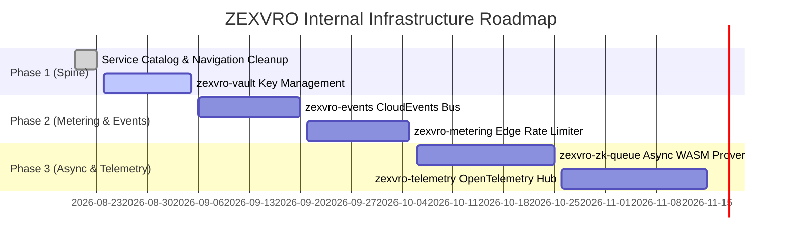

# ZEXVRO Architectural Audit: Proposed Internal Services & Investor Q&A

> **Document Version**: 1.0.0  
> **Author**: Antigravity AI & Paris / ZEXVRO Architecture Team  
> **Target Audience**: Core Engineering Team, Technical Co-founders, VCs & Grant Auditors  

---

## Part 1: Product Gaps Audit & Proposed Internal Services

While ZEXVRO currently delivers 5 powerful user-facing MVP services (**Zer0**, **Morph**, **REQWID**, **NFTo**, and **DEDSEC**), our architectural audit reveals that the platform currently operates as a **federated collection of standalone micro-apps** rather than a deeply integrated PaaS.

To become the "Cloudflare + Alchemy of Web3" on Stellar, ZEXVRO needs **6 core internal platform services** operating behind the console shell. Below is the blueprint for these missing internal services.

---

### 1. `zexvro-events` — Unified Webhook & Event Bus

#### **The Gap Today**
* Each service handles state transitions independently. When an NFTo collection completes a mint, a Zer0 stealth deposit lands on-chain, or DEDSEC blocks an unpaid IP, there is **no centralized event bus** emitting events to external developer webhooks or internal telemetry handlers.
* Developers building on ZEXVRO must poll endpoints manually.

#### **Proposed Solution: `zexvro-events`**
A durable EventBridge/Cloudflare Queue-backed message broker that normalizes all platform events into standard CloudEvents JSON payloads.
```json
{
  "specversion": "1.0",
  "id": "evt_98f7a61b",
  "source": "zexvro.dedsec",
  "type": "dedsec.payment.settled",
  "time": "2026-08-23T17:30:00Z",
  "datacontenttype": "application/json",
  "data": {
    "workspaceId": "ws_123",
    "projectId": "p_456",
    "route": "/v1/inference",
    "amountUsdc": "0.0500000",
    "txHash": "a9b8c7..."
  }
}
```
* **Developer Benefit**: Webhook dashboard under Project Settings where developers register endpoints (`https://my-api.com/webhooks`) with HMAC-SHA256 signature verification.

---

### 2. `zexvro-telemetry` — Unified Logging & Observability Pipeline

#### **The Gap Today**
* Service logs live in disjointed places: DEDSEC and REQWID log to AWS App Runner / Fargate stdout, Zer0 client logs run in the browser console, and Morph logs in Cloudflare Worker tail logs.
* Developers have no workspace-level log viewer inside the ZEXVRO Dashboard to debug 402 payment failures or ZK proof generation errors.

#### **Proposed Solution: `zexvro-telemetry`**
A lightweight OpenTelemetry-compatible log collector and aggregator (backed by AWS CloudWatch Logs / Grafana Loki or ClickHouse) exposed via a Dashboard UI tab called **Logs & Traces**.
* **Features**:
  * Real-time log streaming for every API request across DEDSEC, Zer0, and NFTo.
  * Request correlation IDs (`X-Zexvro-Trace-ID`) spanning client -> gateway -> smart contract -> upstream API.

---

### 3. `zexvro-vault` — Centralized Secret Manager & Key Vault

#### **The Gap Today**
* Secret keys (e.g., DEDSEC upstream headers, Pinata IPFS keys, Zer0 relayer private keys) are currently stored in static `.env` files or isolated AWS Secrets Manager instances.
* There is no developer-facing API or UI for scoped, encrypted API key creation and secret rotation.

#### **Proposed Solution: `zexvro-vault`**
An internal KMS-wrapped Vault service integrated into ZEXVRO IAM.
* **Features**:
  * **Publishable & Secret Keys**: Auto-generate `zk_live_...` (public) and `sk_live_...` (secret) keypairs for developers.
  * **Automatic Key Rotation**: 30-day optional key rotation schedules with zero-downtime grace periods.
  * **RBAC Scoping**: Restrict API key permissions per project (e.g., "Read-only NFTo, Write DEDSEC").

---

### 4. `zexvro-zk-queue` — Asynchronous ZK-Proof Generation Worker Pool

#### **The Gap Today**
* Zer0 ZK proof generation relies on an on-demand AWS EC2 instance (`c6i.xlarge`). When the instance is stopped (to save costs), client requests experience severe cold-start delays or fail.
* Proof generation runs synchronously, blocking client execution.

#### **Proposed Solution: `zexvro-zk-queue`**
An async task queue (SQS / Cloudflare Queues + auto-scaling AWS Fargate / Lambda ZK workers).
* **Workflow**:
  1. Client calls `POST /api/zer0/prove` -> Receives `202 Accepted` with `jobId`.
  2. `zexvro-zk-queue` dispatches proof calculation to an available WASM worker or EC2 ZK prover instance.
  3. Client polls or listens via WebSocket (`zexvro-events`) for completion.
  4. Cost drops by 80% because ZK worker instances spin up on-demand via ECS auto-scaling.

---

### 5. `zexvro-metering` — Centralized Usage & Rate Limiting Engine

#### **The Gap Today**
* ZEXVRO Credits (`ZCR`) are stored in a database, but API requests across DEDSEC and REQWID do not automatically deduct ZCR or enforce per-second rate limits in real-time at the gateway level.

#### **Proposed Solution: `zexvro-metering`**
An edge middleware running on Redis / Cloudflare KV that intercepts incoming API traffic:
* Checks workspace ZCR balance in `<1ms`.
* Enforces rate limits (e.g., 100 req/min for Free tier, 10,000 req/min for Enterprise).
* Deducts ZCR micro-credits per API call and streams usage metrics to `WorkspaceOverview`.

---

### 6. `zexvro-notify` — Multi-Channel Developer Notification Service

#### **The Gap Today**
* System alerts (e.g., low ZCR balance, unauthorized DEDSEC origin access, failed Webhook delivery) rely on in-app toast notices, which vanish when the browser tab is closed.

#### **Proposed Solution: `zexvro-notify`**
A multi-channel notification dispatcher supporting:
* **Discord / Slack Webhooks**
* **Transactional Email (Cloudflare Email / Brevo)**
* **In-App Notification Center** (bell icon in top navigation bar).

---

## Part 2: Common Technical & Investor Q&A (FAQ)

### Q1: How does ZEXVRO differ from traditional Web3 infrastructure providers like Alchemy, Infura, or Privy?
**Answer**:
* **Alchemy/Infura** are raw RPC node providers. They give developers connectivity to blockchains, but leave key management, payment paywalls, ZK privacy, and agentic workflows to the developer.
* **Privy** focuses strictly on embedded wallet authentication.
* **ZEXVRO is an end-to-end Web3 Developer Platform (PaaS)**. We combine ZK privacy payroll (Zer0), x402 API monetization (DEDSEC), bot security (REQWID), digital asset tooling (NFTo), and AI dev agents (Morph) into a single developer console with unified IAM, credits, and telemetry.

---

### Q2: Why build ZEXVRO primarily on Stellar & Soroban instead of Ethereum/EVM chains?
**Answer**:
1. **Sub-second Settlement & Deterministic Fees**: Stellar transactions settle in 3–5 seconds with fixed micro-cent transaction fees, making real-time HTTP 402 micro-payments (DEDSEC) and batch ZK payroll (Zer0) economically viable.
2. **Native USDC Support**: Stellar has native Circle USDC with high liquidity and low transfer overhead.
3. **Soroban Smart Contract Engine**: Built on Rust and WebAssembly (WASM), Soroban offers high execution speeds and memory safety for complex ZK verification and NFT logic.

---

### Q3: How does DEDSEC ensure fail-closed security for protected API endpoints?
**Answer**:
DEDSEC implements a **Proxy-and-Settle Architecture**:
1. When an unpaid client sends a request to a DEDSEC route, the gateway immediately returns `HTTP 402 Payment Required` with a cryptographic payment challenge. **The upstream backend is never called.**
2. When the client retries with a `PAYMENT-SIGNATURE` header, the gateway verifies the Stellar USDC payment against the Stellar network/facilitator.
3. Only after on-chain verification succeeds does DEDSEC forward the request to the upstream origin.
4. If settlement fails or times out, the response body is withheld and HTTP 402/502 is returned.

---

### Q4: How does Zer0 maintain transaction privacy on a public blockchain like Stellar?
**Answer**:
Zer0 uses **Circom Zero-Knowledge (ZK) Proof Circuits & Stealth Addresses**:
* Instead of sending funds directly from Address A to Address B, Zer0 generates a temporary single-use stealth address.
* The sender deposits funds into the Zer0 privacy pool contract with a ZK commitment hash.
* The recipient generates a ZK proof locally in their browser (proving ownership of the secret key without revealing identity) and submits the proof to withdraw funds.
* On-chain observers only see interaction with the privacy pool contract; the link between sender and receiver is cryptographically broken.

---

### Q5: What is the current monthly infrastructure cost to run ZEXVRO, and how does it scale?
**Answer**:
* **Current Baseline Run-Rate**: ~$86/month (covered by AWS Activate & Cloudflare Free tiers).
  * 2× AWS App Runner instances: ~$46/mo
  * AWS Application Load Balancer: ~$18/mo
  * AWS Fargate `zexvro-gate`: ~$9/mo
  * EIPs & DynamoDB: ~$13/mo
  * ZK EC2 Prover (`c6i.xlarge`): $0/mo (stopped when idle).
* **Scaling Path (to 10,000 active developers)**:
  * By transitioning ZK prover workloads to `zexvro-zk-queue` (serverless Fargate auto-scaling) and hosting API gateways on Cloudflare Workers, infrastructure costs scale linearly with developer usage and are fully offset by ZCR credit purchases and DEDSEC gateway transaction fees (0.5% protocol fee).

---

### Q6: Is ZEXVRO mainnet ready today?
**Answer**:
**Yes.**
* **Zer0** and **NFTo** are live on Stellar Mainnet.
* **DEDSEC** gateway is operational on Stellar Testnet and Pubnet.
* **REQWID** and **Morph** are in active developer stage, with complete SDKs and console interfaces ready for demonstration.

---

## Part 3: Implementation Roadmap for Proposed Services



---

*This document serves as the official architectural reference for ZEXVRO core platform development and VC diligence.*
