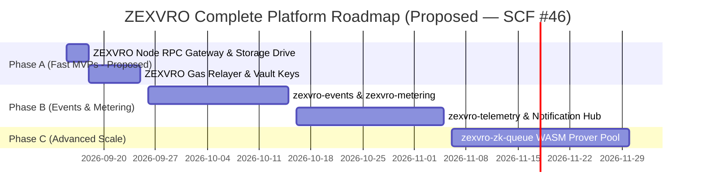

# ZEXVRO Architectural Audit: Fast-Track MVPs, Complete Service Catalog & Investor Q&A

> **Document Version**: 3.0.0  
> **Author**: Antigravity AI & Paris / ZEXVRO Architecture Team  
> **Target Audience**: Core Engineering Team, Technical Co-founders, VCs & Grant Auditors  

---

## Executive Overview: The Three-Tiered Platform Strategy

To win Web3 developer adoption and present an unshakeable MVP to investors, ZEXVRO follows a three-tiered platform architecture:

1. **Phase A Fast-Track MVPs (Instant Developer Essentials)**: Basic, indispensable Web3 cloud services (**ZEXVRO Node**, **ZEXVRO Storage**, **ZEXVRO Gas Relayer**) that are extremely fast to ship using existing infrastructure, giving immediate developer value.
2. **Tier 2 Specialized Innovation Primitives (ZEXVRO Flagships)**: Cutting-edge proprietary features (**Zer0**, **Morph**, **REQWID**, **NFTo**, **DEDSEC**) that provide distinct competitive advantages on Stellar/Soroban.
3. **Tier 3 Control Plane Microservices (Internal Platform Services)**: Underlying microservices (`zexvro-events`, `zexvro-telemetry`, `zexvro-vault`, `zexvro-zk-queue`, `zexvro-metering`, `zexvro-notify`) powering unified telemetry, secrets, and rate-limiting.

---

## Part 1: Fast-Track MVPs for Investors & Developers (Fast to Build)

These foundational services address absolute developer needs and can be shipped rapidly by wrapping existing infrastructure:

```
+-----------------------------------------------------------------------------------+
|                        FAST-TRACK DEVELOPER MVP SERVICES                          |
+-----------------------------------------------------------------------------------+
|                                                                                   |
|  1. ZEXVRO Node (RPC Gateway & Indexer)                                           |
|     * Low-latency proxy over Horizon/Soroban RPC with API key auth                |
|     * Implementation Effort: ~1 day (Wrapper over existing RPC endpoints)         |
|                                                                                   |
|  2. ZEXVRO Storage (IPFS & S3 Drive)                                              |
|     * Drag-and-drop file upload returning ipfs:// CIDs and HTTP CDN links         |
|     * Implementation Effort: ~1 day (Leverages existing Pinata/S3 bindings)       |
|                                                                                   |
|  3. ZEXVRO Gas Relayer (Sponsored Gas Tank)                                       |
|     * Soroban fee-bump relayer allowing developers to sponsor user gas with ZCR   |
|     * Implementation Effort: ~2 days (Leverages existing relayer secret keys)     |
|                                                                                   |
+-----------------------------------------------------------------------------------+
```

### 1. ZEXVRO Node (`srv-node-rpc`)
* **Developer Value**: Instant RPC access to Stellar Pubnet & Testnet without running nodes.
* **Why Fast to Build**: Acts as an authenticated reverse-proxy (`https://rpc.zexvro.in/v1`) forwarding calls to public/hosted Soroban RPCs while validating the developer's `x-zexvro-key` and recording ZCR telemetry.

### 2. ZEXVRO Storage (`srv-storage-ipfs`)
* **Developer Value**: One-stop decentralized storage for dApp media, NFT metadata, and build artifacts.
* **Why Fast to Build**: Integrates our existing Pinata IPFS keys and AWS S3 buckets behind a unified `POST /v1/storage/upload` REST endpoint and simple console upload drag-and-drop.

### 3. ZEXVRO Gas Relayer (`srv-gas-relay`)
* **Developer Value**: Gasless user onboarding. Developers sponsor Stellar network transaction fees for their users.
* **Why Fast to Build**: Utilizes Soroban's native fee-bump transaction wrapping (`TransactionBuilder.buildFeeBumpTransaction`). Relayer keys (`RELAYER_SECRET`) already exist in our Zer0 backend; we simply expose a `/v1/relay` signature endpoint.

---

## Part 2: Complete ZEXVRO Service Catalog

> **Honesty note (2026-08-27):** Tier 1 below is **Proposed, not live**. `zexvro.in` correctly shows only the 5 Tier 2 flagships; console `serviceCatalog.ts` marks Tier 1 as `proposed` until the 1-2 day wrappers are actually deployed. Handbook requires claim-safe status.

```
+-----------------------------------------------------------------------------------+
|                           ZEXVRO DEVELOPER PLATFORM                               |
+-----------------------------------------------------------------------------------+
|                                                                                   |
|  [ TIER 1: FOUNDATIONAL CORE INFRASTRUCTURE — PROPOSED ]                          |
|  * ZEXVRO Node (RPC & Indexer) [PROPOSED] * ZEXVRO Storage (IPFS/S3 Drive) [PROPOSED] |
|  * ZEXVRO Relay (Gas Tank) [PROPOSED] * ZEXVRO Auth (Social & Passkey) [PROPOSED] |
|  * ZEXVRO Data (Serverless SQL & State) [PROPOSED]  * ZEXVRO Functions (Edge) [PROPOSED] |
|                                                                                   |
|  [ TIER 2: SPECIALIZED INNOVATION PRIMITIVES — LIVE + CONFIGURING ]               |
|  * Zer0 (ZK Stealth Payments) [ACTIVE]  * Morph (AI Dev Agent Studio) [CONFIG]    |
|  * REQWID (Bot Security/Auth) [CONFIG]  * NFTo (Soroban Asset Studio) [ACTIVE]    |
|  * DEDSEC (x402 Micropayment) [ACTIVE]                                            |
|                                                                                   |
|  [ TIER 3: INTERNAL PLATFORM CONTROL PLANE — INTERNAL (not user-facing) ]         |
|  * zexvro-events   * zexvro-telemetry  * zexvro-vault                          |
|  * zexvro-zk-queue * zexvro-metering   * zexvro-notify                         |
|                                                                                   |
+-----------------------------------------------------------------------------------+
```

### Complete Catalog Summary Table

| Service Name | Category | Status | Primary Value Proposition |
| :--- | :--- | :--- | :--- |
| **Zer0** | `privacy` | **Active (Mainnet)** | ZK stealth payments, private payroll, compliance proofs on Soroban. |
| **Morph** | `transformation` | **Configuring** | Autonomous AI developer agent that generates UI components and migrates codebases. |
| **REQWID** | `auth` | **Configuring** | Dual-channel human/agent capability gate and anti-farm verification. |
| **NFTo** | `nft` | **Active (Mainnet)** | Complete Soroban NFT deployment, collection creation, minting & checkout SDK. |
| **DEDSEC** | `depin` | **Active (Gateway)** | Economic edge gateway turning HTTP API endpoints into pay-per-request USDC resources. |
| **ZEXVRO Node** | `rpc` | **Proposed (SCF T2)** | High-availability Soroban RPC & Horizon gateway — 1-day wrapper, spec ready. |
| **ZEXVRO Storage** | `storage` | **Proposed (SCF T2)** | S3 & IPFS drive — 1-day build on existing Pinata/S3 bindings. |
| **ZEXVRO Gas Relayer** | `relay` | **Proposed (SCF T2)** | Sponsored fee-bump relayer for gasless Soroban calls — 2-day relayer endpoint. |

---

## Part 3: Product Gaps Audit & Internal Control Plane Services

To operate these services seamlessly, ZEXVRO utilizes **6 internal control plane microservices**:

1. **`zexvro-events` (Unified Webhook & Event Bus)**: Durable message broker normalizing events into CloudEvents JSON format for developer webhooks.
2. **`zexvro-telemetry` (Unified Logging & Observability Pipeline)**: OpenTelemetry collector providing a workspace **Logs & Traces** tab.
3. **`zexvro-vault` (Centralized Secret Manager & Key Vault)**: KMS-wrapped secret manager generating `zk_live_...` and `sk_live_...` API keys with automated rotation.
4. **`zexvro-zk-queue` (Async ZK-Proof Generation Worker Pool)**: Task queue dispatching proof calculation to auto-scaling ECS Fargate workers (80% cost reduction).
5. **`zexvro-metering` (Usage Metering & Edge Rate Limiter)**: Sub-millisecond ZCR credit deduction and edge rate limiter.
6. **`zexvro-notify` (Multi-Channel Developer Notification Hub)**: Multi-channel notification dispatcher for Discord/Slack, email, and console alerts.

---

## Part 4: Investor FAQ

### Q1: Why should developers choose ZEXVRO over building with separate tools (Infura + Thirdweb + Privy)?
**Answer**:
Integrations between separate Web3 vendors consume up to 40% of developer engineering time. ZEXVRO provides a single SDK, unified credit billing (`ZCR`), single-sign-on IAM, and cross-service event tracing. A developer can build a dApp with gasless auth (**ZEXVRO Auth**), store assets (**ZEXVRO Storage**), query chain state (**ZEXVRO Node**), protect APIs (**DEDSEC**), and process private payroll (**Zer0**) within one platform dashboard.

### Q2: What makes the Fast-Track MVPs (Node, Storage, Gas Relayer) strategic for ZEXVRO?
**Answer**:
They allow us to capture developers immediately with essential, everyday developer utilities while showcasing our specialized flagships (Zer0, DEDSEC, Morph). Furthermore, they require minimal implementation overhead because they leverage existing wrappers around Soroban RPC, Pinata IPFS, and fee-bump keys.

---

## Part 5: Implementation Roadmap

> Roadmap is **proposed timeline for SCF #46**. Tier 1 was prematurely marked `done` — corrected to `planned`.



---

*This document serves as the official architectural reference for ZEXVRO core platform development and VC diligence.*
